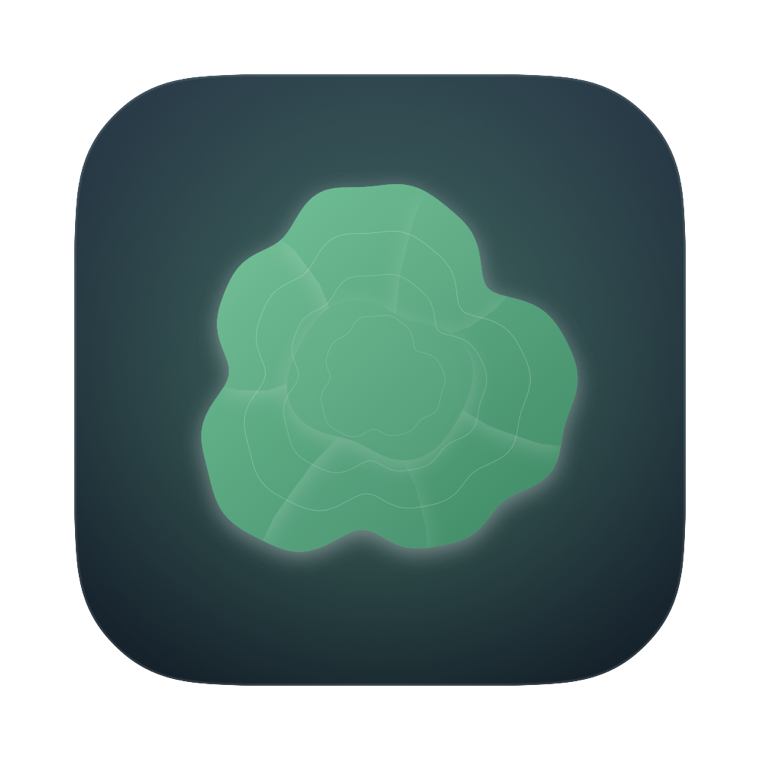
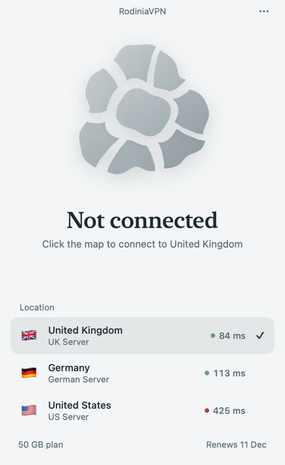
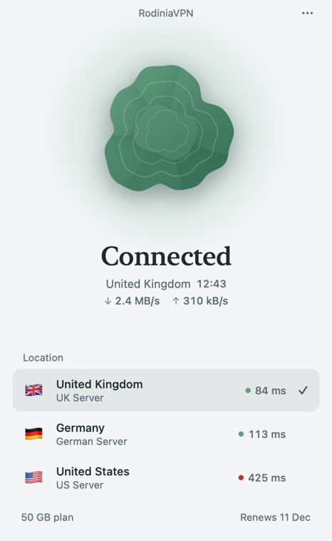

<p align="center"></p>

# Rodinia

A native macOS VPN client for VLESS + Reality, built with SwiftUI and Xray-core.

<p align="center">
  <a href="https://github.com/zachgree/rodinia-client/releases/latest/download/Rodinia.dmg"></a>
</p>
<p align="center"><sub>macOS 15 or later · Apple Silicon and Intel · signed and notarized by Apple</sub></p>

### Install

1. Download **Rodinia.dmg** and open it.
2. Drag **Rodinia** into **Applications**, then open it from there.
3. Paste your subscription link.
4. The first time you connect, macOS asks for two permissions:
   - Allow Rodinia in **System Settings → General → Login Items & Extensions → Network Extensions**.
   - Choose **Allow** when it asks to add a VPN configuration.

Rodinia updates itself: it downloads new versions in the background and installs them the next time you quit it. To check now, choose **Rodinia → Check for Updates…** or use the **⋯** menu.

Rodinia was the supercontinent that joined every landmass about a billion years ago. The app takes its look from that: while you're disconnected, the map sits in pieces. Click it and the plates drift together. Once the tunnel is up, they fuse into one continent.

<p align="center">
  
  
</p>

## What it does

- Works with any standard subscription link: a base64 list of `vless://` links, the format 3X-UI, Marzban and most panels serve
- Reads `Profile-Title`, `Profile-Update-Interval` and `Subscription-Userinfo`, so you see your plan, renewal date and provider name
- Live latency for each location, plus throughput and session time while you're connected
- Sends all traffic through the tunnel, DNS and UDP included. Local network traffic stays local
- Menu bar control, ⌘K to connect, ⌘1–9 to switch location
- Light and dark mode both designed, and every animation respects Reduce Motion
- Updates itself with [Sparkle](https://sparkle-project.org), checking signed releases from this repository

## How it works

| Part | What it is |
|---|---|
| `App/` | SwiftUI app: window, menu bar extra, onboarding |
| `Tunnel/` | Packet tunnel provider, shipped as a system extension |
| `Packages/RodiniaKit/` | Link parsing, subscriptions, Xray config generation. Shared with the future iOS app |
| `Core/` | A small Go bridge to [Xray-core](https://github.com/XTLS/Xray-core), built with gomobile into `RodiniaCore.xcframework` |

The tunnel hands NetworkExtension's utun file descriptor straight to Xray's TUN inbound (`xray.tun.fd`), so packets go from the kernel to Xray with no tun2socks layer in between.

## Building

Requirements: macOS 15+, Xcode 26, Go, [XcodeGen](https://github.com/yonaskolb/XcodeGen) and an Apple Developer account. A packet tunnel can't be signed without one.

```sh
brew install go xcodegen
cp Config/Local.xcconfig.example Config/Local.xcconfig   # add your team ID and bundle prefix
scripts/build-core.sh                                    # builds Xray-core (first run takes a few minutes)
xcodegen generate
open Rodinia.xcodeproj
```

macOS only loads system extensions from apps in `/Applications`. Build, copy `Rodinia.app` there and open it from there. The first time you connect, macOS asks you to allow the extension in System Settings and to allow the VPN configuration.

Run the RodiniaKit tests with `swift test --package-path Packages/RodiniaKit`.

### Design snapshots

Debug builds can render every screen to PNG without a working tunnel:

```sh
Rodinia.app/Contents/MacOS/Rodinia -snapshots /tmp/rodinia-snaps
```

## Releasing

Bump `MARKETING_VERSION` and `CURRENT_PROJECT_VERSION` in `Config/Base.xcconfig`, then:

```sh
scripts/release.sh   # universal build, Developer ID signing, notarized and stapled app and dmg, signed appcast
scripts/publish.sh   # GitHub release v<version> with Rodinia.dmg and appcast.xml, marked latest
```

Optional release notes go in `scripts/notes/<version>.md` for GitHub and `scripts/notes/<version>.html` for the update window.

Every release keeps the file names `Rodinia.dmg` and `appcast.xml`, so the download button and the in-app updater (`releases/latest/download/appcast.xml`) always find the newest build. `CURRENT_PROJECT_VERSION` must go up each time: Sparkle compares it, and macOS only replaces the installed tunnel extension when it changes.

One-time setup:

- `xcrun notarytool store-credentials rodinia-notary`
- An update signing key. Sparkle's `generate_keys --account rodinia` (in `.build/release/SourcePackages/artifacts/sparkle/Sparkle/bin/`) stores it in your keychain and prints the public key for `UPDATE_PUBLIC_KEY`. Back it up with `generate_keys --account rodinia -x key.txt`: without it, installed copies can never be updated again.

## License

[Mozilla Public License 2.0](LICENSE), the same as Xray-core.
